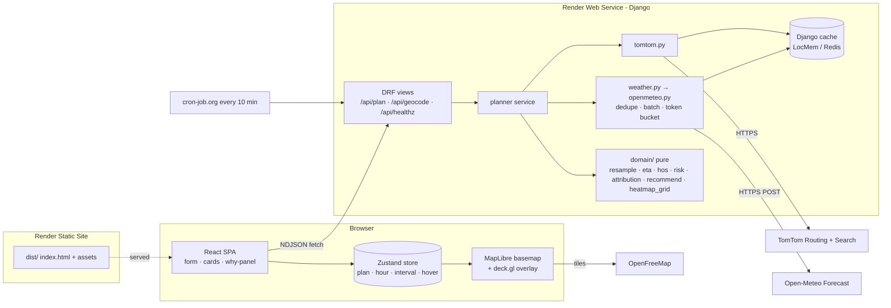

# PLAN — Spotter Full-Stack Assessment: Weather-Aware Truck Routing

Status: approved decisions recorded (2026-11-14). Nothing is built yet. Every section maps to a grading bucket: **[L]** logic 40%, **[U]** UI/map 40%, **[Q]** code quality 15%, **[D]** docs 5%.

---

## 1. Tooling setup

| Item | Status | Why |
|---|---|---|
| Built-in skills available | `skill-creator`, `code-review`, `simplify`, `security-review`, `run`, `dataviz`, built-in browser skill | Code review before each milestone commit [Q]; `dataviz` for an accessible risk color scale [U]; browser for UI verification [U] |
| MCP / tools available | Built-in browser (`mcp__Claude_Browser__*`, preview servers, screenshots, console, network), Claude in Chrome, WebSearch/WebFetch | UI verification loop, live API doc checks |
| Plugins suggested (install card shown; you install) | **frontend-design**: polish for cards, legend and slider [U]. **context7**: version-correct MapLibre/deck.gl/DRF/TanStack docs during the build [Q]. **playwright** MCP: scripted browser checks while writing E2E [U] | Each one targets a high-weight bucket. I skipped the other review and design plugins as noise. |
| Project skills created | `.claude/skills/risk-rules`, `api-contracts`, `map-performance`, `verify-ui` | Keep every build session consistent on the 40%/40% buckets |
| `CLAUDE.md` | Created | Stack, commands, layout, conventions, definition of done |
| `.claude/settings.json` | Created | Allowlist for make/uv/pnpm test, lint, dev and git read commands. Denies reading `.env` and force-push |
| `.claude/launch.json` | Created | `api` (fixture mode) and `web` preview servers for the browser pane |
| Local toolchain | node 24, pnpm, uv present. System Python is 3.9, so uv will install **Python 3.12**. **`gh` is missing**: run `brew install gh` before M0 to create the GitHub repo. The folder is not a git repo yet; M0 runs `git init`. | |

Skill evals (the skill-creator loop) were skipped on purpose. These skills are reference documents and their real test is the build sessions.

**API facts were verified live or against docs on 2026-11-14** (citations in §5 and in `api-contracts`). Two findings shaped the design:
1. **TomTom** supports `travelMode=truck`, `vehicleWeight` (kg), `maxAlternatives` 0–5, and returns **cumulative per-point `travelTimeInSeconds`** (`extendedRouteRepresentation=travelTime`). That gives true ETAs instead of proportional estimates.
2. **Open-Meteo counts every location in a batched request against its 600/min quota.** I measured this directly: 600 locations in about a minute returned HTTP 429. Point dedup and caps are therefore mandatory, not optional.

Rejected after research: **OpenRouteService HGV**, because its hosted API caps alternative routes at 100 km ([restrictions](https://giscience.github.io/openrouteservice/hosted-api-restrictions)), which rules out real truck trips.

---

## 2. Spec interpretation & assumptions (reviewer-facing)

### 2.1 Decisions on ambiguous spec points (approved)

| # | Ambiguity | Interpretation | Why |
|---|---|---|---|
| S1 | "Sample every 10 / 25 / 50 miles" | We compute **all three** in one response, and a UI toggle switches between them instantly. Each interval has its own aggregates and recommendation. | Covers every reading of the spec, and shows whether the recommendation holds across sampling density. The 50-mile marks are a subset of the 10-mile marks, so the extra cost is only the 25-mile odd marks (about +20%). |
| S2 | Overlapping or integer-only bands | **Lower bound inclusive** `[low, high)`. A boundary value goes to the worse band. Explicit `>` is honored: rain 1.00 = Severe, snow 3.0 = Severe. No rounding. | One rule everywhere, consistent with "≥55", and conservative for safety. Examples: rain 0.25 → High, wind 34.6 → Moderate, snow 1.0 → High. |
| S3 | Combining conditions, wind metric | Level = `max(wind_after_load_rules, rain, snow)`. Wind = **sustained 10 m wind** (`wind_speed_10m`). Gusts are shown, not scored. Rain = `rain + showers`. | No invented thresholds. Scoring gusts would push most of a route to Moderate+ and make routes indistinguishable. |
| S4 | Miles from point checkpoints | **Half-interval ownership.** Each checkpoint owns half of the gap to each neighbor. Origin and destination are checkpoints. Owned miles sum exactly to route length. | Unbiased and testable (property test: Σ owned = L). |
| S5 | "No Travel" in the ranking | A **step 0** is added before the spec's 4 steps: fewest No-Travel miles. A red banner and card badges flag NT. If all routes have NT, they are still ranked, plus a blocking banner says "No safe route at this departure". | NT is strictly worse than Severe, and this keeps the spec's order intact. |
| S6 | "Lowest average risk" scale | Low 0, Moderate 1, High 2, Severe 3, NT 4, **distance-weighted by owned miles**. NO_DATA miles are excluded. | Matches how Severe and High are counted (in miles). |
| S7 | Weather time ↔ ETA | Per-variable semantics. Wind (instantaneous) is linearly interpolated between hours. Rain and snow (preceding-hour sums) use the bucket containing the ETA, label `ceil_hour(eta)`, already in/hr. All UTC. | Matches Open-Meteo's documented data semantics exactly. |
| S8 | Departure range, forecast horizon | `departure_local` is in the origin's time zone (via `timezonefinder`). Allowed range is now−15 min (clamped to now) to now+7 days. Weather is looked up up to 16 days out. Missing values → checkpoint `NO_DATA` plus a warning. The slider covers 0–48 h **from departure** (labels in origin local time). | Lets drivers plan ahead without archive APIs. |
| S9 | Hours-of-service | An **optional toggle, default off.** When on, a pure function inserts a 30 min break after 8 h of cumulative driving and a 10 h off-duty rest after 11 h of driving (49 CFR §395.3, [eCFR](https://www.ecfr.gov/current/title-49/subtitle-B/chapter-III/subchapter-B/part-395/section-395.3)). It assumes fresh clocks and ignores the 60/70 h rule. | Shows trucking domain knowledge without changing the default spec behavior. Off = raw TomTom truck travel time. |
| S10 | Fewer than 3 routes | Request `maxAlternatives=4` and dedupe routes with more than 85% shared length. If fewer than 3 remain, generate **via-point detours**: the route midpoint offset perpendicular by `clamp(15% × straight-line distance, 20 km, 150 km)` on each side, accepted if distinct and ≤ 1.5× the fastest duration. If there are still fewer than 3, show what exists plus a `FEWER_THAN_3_ROUTES` banner. | Never fakes a third route. |

### 2.2 Assumptions (conventions decided without asking)
- Units: input weight in **lb**. Distances shown in miles, speeds in mph, precipitation in in/hr. TomTom gets kg (`lb × 0.45359237`, rounded).
- Weight validation is `1–200,000 lb`. Above 80,000 lb (federal gross limit) shows a warning but is allowed (permit loads).
- Region: geocoding is restricted to `US, CA, MX` (units and truck context). The routing and weather logic is global.
- Route labels are A/B/C in TomTom order (A = TomTom's primary). The final comparator tie-break is that order.
- Comparator float noise: miles are compared at 0.1 mi, average risk at 0.01, time at 1 minute.
- Checkpoint coordinates snap to a **0.1° lattice** (≤ about 7 km displacement, near the model grid scale) for weather lookup only. Displayed positions stay exact.
- Checkpoint ETAs are wall-clock arrival times. With HOS on, a checkpoint reached right before a stop takes the pre-stop time. Weather while parked is not assessed.
- Displayed times use the origin's time zone. Popups add the checkpoint's local time when it differs.
- Open-Meteo `best_match` model (blends HRRR/NBM/GFS for the US). Free tier = non-commercial, which fits a take-home. An optional `OPEN_METEO_API_KEY` switches to the commercial host.
- Heatmap colors show the **risk level for the entered load weight** (load rules applied), on the same scale as the checkpoints.

---

## 3. Decision log (ADR)

| # | Decision | Choice | Why (bucket) | Rejected |
|---|---|---|---|---|
| 1 | Interval meaning | All 3 computed, UI toggle | Every interpretation covered, instant switch [L][U] | Pick in form; auto by length |
| 2 | Boundaries | Lower-bound inclusive, honor explicit `>` | Single consistent rule, conservative [L] | Round-then-classify; upper inclusive |
| 3 | Wind metric | Sustained 10 m; gusts display-only | No invented thresholds [L] | max(sustained, gust); gusts only |
| 4 | Mile attribution | Half-interval ownership, endpoints included | Unbiased, sums to L [L] | Worse endpoint; forward-fill |
| 5 | No Travel / avg risk | Step 0 = NT miles; 0–4 distance-weighted avg | Faithful order, explicit safety [L] | NT as Severe; NT disqualifies |
| 6 | Time matching | Wind interpolated; precip bucket containing ETA | Matches data semantics [L] | Nearest hour; interpolate all |
| 7 | Horizon | Depart now…+7 d, lookup to 16 d, NO_DATA beyond | Realistic planning [L] | ≤48 h only; historical |
| 8 | HOS | Optional toggle, default off | Domain signal, no core risk [L] | Always on; none |
| 9 | Routing | TomTom (truck, kg, ≤5 alternatives, per-point time) | 3 routes plus exact ETAs, no card [L] | HERE; ORS (100 km alternative cap); Mapbox |
| 10 | Weather sampling | Snap 0.1°, dedupe, heatmap ≤ 250 cells, batches of 100, 500/min bucket, 1 h cache | Fits per-location quota [L] | Exact coords; one shared lattice |
| 11 | Map | MapLibre + deck.gl (`MapboxOverlay`, interleaved), OpenFreeMap tiles | GPU, stable layers, free [U] | MapLibre only; Leaflet; Google |
| 12 | Heatmap | Precomputed 49 frames of risk cells, crossfade, truck ghosts | No network on scrub, same scale as checkpoints [U] | KDE HeatmapLayer; fetch per hour |
| 13 | Backend | Django 5.2 + DRF, sync views + ThreadPoolExecutor, httpx, drf-spectacular → TS types | Familiar to reviewers, simple to test [Q] | Django Ninja async; plain async views |
| 14 | Frontend | Vite + React + strict TS, TanStack Query, Zustand, Tailwind + Radix/shadcn | Selector subscriptions keep slider ticks out of React [U][Q] | Context + CSS modules; MUI |
| 15 | Hosting | Render free: **Static Site (SPA)** + **free web service (API)**, keep-warm ping | $0; SPA never sleeps, API wake is visible and explained [U] | Render Starter; Fly.io; single WhiteNoise service |
| 16 | Testing / CI | Full pyramid + GitHub Actions | Proof of correctness [L][Q] | Unit only; perf gate in CI |
| 17 | Progress delivery | NDJSON stream on `POST /api/plan` (+ JSON mode) | Routes drawn ~1.5 s, honest progress, stateless [U] | Two-phase endpoints; single JSON |
| 18 | Geocoding | TomTom Fuzzy Search `typeahead=true`, proxied | Same key, returns coordinates [U] | Photon; Open-Meteo geocoding |

---

## 4. Architecture

**Request flow for "Plan trip":**
1. The form validates (zod). `useMutation` POSTs `/api/plan` with `Accept: application/x-ndjson` and an `AbortController` (a resubmit cancels the previous request).
2. The view validates the serializer, resolves the origin time zone, converts the departure to UTC, and returns `StreamingHttpResponse(planner.stream(req))`.
3. The planner calls TomTom (cache key = OD, departure rounded to 15 min, weight; TTL 15 min). It dedupes routes and adds via-point detours if fewer than 3 remain. It yields `meta` and `routes`, and the client draws grey routes.
4. The domain resamples each route at 10/25/50 mi, attaches ETAs from `progress[]` (with HOS stops if the toggle is on), snaps lookup points to 0.1°, and builds the heatmap lattice.
5. Weather service: union and dedupe of points, cache lookup, then the misses go out as POST batches of 100 through a thread pool (≤ 4 in flight) with a token bucket (500 locations/min). It yields a `progress` event per batch.
6. Domain: time-align → classify → attribute miles → aggregate → recommend for each interval → encode the heatmap. It yields `result`.
7. The client decodes once (polyline6 and base64 typed arrays to precomputed RGBA frames) and stores the result in Zustand. Layers update and the cards render. The slider, the interval toggle and hover make no further network calls.

Process model: `gunicorn config.wsgi -k gthread --workers 1 --threads 8 --timeout 60`. One process means LocMem is shared across threads. I/O-bound work suits threads.

---

## 5. Domain model & algorithms (all in `backend/trips/domain/`, pure, `mypy --strict`)

### 5.1 Types (`types.py`, frozen dataclasses)
`LatLon(lat, lon)`, `RouteGeom(points: list[LatLon], cum_m: list[float], cum_s: list[float], length_m, duration_s)`, `Checkpoint(mile, pos, kind, owned_mi, eta_utc, lookup_cell)`, `Weather(wind_mph, gust_mph, rain_in_hr, snow_in_hr)`, `Assessment(level, levels, triggers, status)`, `Aggregates`, `Recommendation`.

### 5.2 Polyline resampling (`geometry.py`, `resample.py`)
- Haversine with `R = 6_371_008.8 m` (IUGG mean radius) and `METERS_PER_MILE = 1609.344`.
- `cum_m[0] = 0`, `cum_m[i] = cum_m[i-1] + haversine(p[i-1], p[i])`. **Normalize** by `k = tomtom.lengthInMeters / cum_m[-1]` so the mileage matches the TomTom total exactly (the difference is usually under 0.5%).
- `resample(route, interval_mi) -> list[Checkpoint]`: marks `m = 0, I, 2I, … < L`, plus `L`. For each mark, binary-search the segment `i` with `cum_m[i] ≤ d < cum_m[i+1]`, then `f = (d - cum_m[i]) / seg`, and position = lerp in lat/lon (segments are under 1 km, so the error is negligible).
- Property tests (hypothesis): marks are monotonic, the first is the origin, the last is the destination, the spacing equals I except the last gap, and every point lies on the polyline (≤ 1 m).

### 5.3 ETA (`eta.py`, `hos.py`)
- TomTom `progress[]` gives `(pointIndex, distanceInMeters, travelTimeInSeconds)` cumulative entries. For every vertex, `cum_s` is interpolated linearly by `cum_m` between bracketing progress entries (the method TomTom's docs prescribe). Checkpoint `driving_s` is interpolated the same way at distance `d`.
- `eta_utc = departure_utc + driving_s + hos_stops_before(driving_s)`.
- `hos.plan_stops(total_driving_s) -> list[Stop(at_driving_s, duration_s, kind)]`: walk the driving clock. When `since_break` reaches 8 h, add a 30 min break. When `shift_drive` reaches 11 h, add a 10 h rest and reset both counters. This is pure and tested (examples: 7 h trip → 0 stops; 9 h → 1 break at 8 h; 20 h → break at 8 h, rest at 11 h, break at 19 h).
- Stops appear on the map as small "☕ 30 min" / "🛏 10 h" markers at their mile.

### 5.4 Weather lookup (`services/weather.py`, `domain/timealign.py`)
- `snap(p) = (round(lat, 1), round(lon, 1))`. Lookup keys are the union of all checkpoint cells (3 routes × 3 intervals) and the heatmap cells.
- One time window per plan: `start = floor_hour(departure_utc) - 1 h`, `end = ceil_hour(max(last_eta, T0 + 48 h)) + 1 h`. That is ≤ 11 days, so each location counts as 1 call.
- Cache per `(cell, start, end)` with a 60 min TTL. Misses are chunked into batches of 100, POSTed with `timeformat=unixtime`, `wind_speed_unit=mph`, `precipitation_unit=inch`, and run in parallel (≤ 4) behind a token bucket of 500 locations/min. A 429 is retried with jittered backoff (1 s, 3 s) and then raises `UpstreamRateLimited`.
- Budget guard: if unique locations exceed 550, coarsen the heatmap stride first, then checkpoint snapping (0.1° → 0.2°) for intervals 25 and 50 only. The plan carries a warning naming what was coarsened.
- `timealign.wind_at(series, t)` interpolates linearly. `timealign.precip_at(series, t)` returns `series[ceil_hour(t)]`, and `rain = rain + showers`. A null value gives NO_DATA.

### 5.5 Risk classification (`levels.py`, `risk.py`)
The exact rules are in the `risk-rules` skill (the single source). Signature:
`assess(w: Weather | None, weight_lb: float) -> Assessment` is pure. It returns the overall level, the per-variable levels and the trigger list. It is used identically for checkpoints and heatmap cells.

### 5.6 Attribution, aggregates, recommendation (`attribution.py`, `recommend.py`)
- `owned_mi[i] = (min(L, (m[i]+m[i+1])/2) - max(0, (m[i-1]+m[i])/2)) / 1609.344`.
- `aggregate(checkpoints) -> Aggregates`: miles by level, NO_DATA miles, distance-weighted `avg_risk`, and `max_level`.
- `recommend(routes) -> Recommendation`: sort by `key = (nt, severe, high, avg, duration_min, index)` with the rounding from the skill. `decided_by[r]` is the first step where `key(r)` differs from `key(winner)`. Ties at every step resolve by route index and are reported as `"route_order"`.
- Note: "balancing risk and travel time" is implemented exactly as the spec's lexicographic order. Time only decides between routes with equal risk. The README calls this out.

### 5.7 Heatmap corridor (`heatmap_grid.py`)
- Lattice stride `s = 0.1° × k` with `k ∈ {2, 3, 4, 5}`, the smallest that yields ≤ 250 cells. Because it is a multiple of 0.1°, heatmap cells share the cache with checkpoint cells.
- Corridor = lattice points inside the union bounding box, ± buffer, whose distance to any route (simplified with Douglas–Peucker at 500 m, equirectangular local projection) is ≤ `max(0.75 × s × 111 km, 20 km)`.
- Values for frames `k = 0..48` at `T0 + k h` use the same `wind_at` and `precip_at` functions and `assess(…, weight_lb)`.
- Encoding: `levels` Uint8 (255 = no data), `wind×10`, `rain×1000`, `snow×100` as Uint16 LE (65535 = no data), frame-major, base64.
- **Payload estimate** for 250 cells: 12,250 values per array. Levels 12 KB plus 3 × 24.5 KB is about 86 KB binary, about 115 KB base64, about 60 KB gzip. Routes (polyline6, Douglas–Peucker at 20 m, ~800 points each) are about 15 KB. About 480 checkpoints × ~250 B JSON is about 120 KB raw, about 20 KB gzip. **Total is about 100 KB gzip** for a 1,000-mile trip (target ≤ 150 KB).

### 5.8 Route dedupe (`routes_select.py`)
Two routes are "the same" if ≥ 85% of the shorter route's 1-mile resample points lie within 300 m of the other. From the distinct candidates, keep A (the fastest) plus the two that maximize minimum pairwise difference, as defined in §2.1 S10.

---

## 6. API contract
The full JSON (request, NDJSON events, Plan, Checkpoint, Aggregates, Recommendation, Heatmap, geocode, healthz, error table) lives in **`.claude/skills/api-contracts/SKILL.md`**, the single source of truth. A summary:

| Endpoint | Success | Errors |
|---|---|---|
| `POST /api/plan` (`application/x-ndjson` or `application/json`) | 200, stream `meta → routes → progress* → result` | 400 VALIDATION · 422 NO_ROUTE · 429 RATE_LIMITED · 502/503/504 UPSTREAM_* · in-stream `{"type":"error"}` |
| `GET /api/geocode?q=&limit=` | 200 `{results:[{label,lat,lon,kind}]}` | 400, 503 |
| `GET /api/healthz` | 200 `{status, version}` | — |

Headers: `Server-Timing: tomtom;dur=…, openmeteo;dur=…, compute;dur=…` (JSON mode), `X-Request-ID`. The DRF throttle allows 10 plans/min/IP and 60 geocodes/min/IP. In `PLAN_FIXTURES=1` mode, the `X-Fixture: two_routes|no_travel_all|upstream_429|no_route` header (forwarded from `?fixture=`) selects recorded scenarios.

---

## 7. Frontend UX [U]

**Layout (desktop ≥ 1024 px):** a left panel (400 px, scrolls) and the map filling the rest.
- Left panel: **Trip form** (origin and destination autocomplete combobox, datetime-local labeled with the origin tz once known, load weight with lb suffix and a 0–80k slider shortcut, HOS switch, "Plan route" and "Try demo trip" buttons) → **interval segmented control** `10 | 25 | 50 mi` → **3 route cards** → **"Why this route?"** panel.
- Route card: label and color swatch, "Recommended" badge, distance, duration (with HOS stops when on), ETA, a stacked mileage bar by level (Low…NT) with mile labels, avg risk, worst level chip, NT/Severe badges.
- Map: routes as `PathLayer`. Non-selected routes are grey with a casing. The selected route is colored per checkpoint-owned segment by level. Checkpoints are `ScatterplotLayer` dots colored by level. HOS stop markers, origin and destination pins. The heatmap cells sit under the labels. **Bottom bar:** a play/pause button, a 0–48 h slider (fractional, keyboard step 1 h), and current time labels ("Sat 06:00 MST · +5 h"). **Legend** at the bottom right: 5 levels with text and a short rule hint.
- **Mobile (< 768 px):** the map takes the top 55% and a bottom sheet holds the Trip / Routes / Why tabs. The slider is docked above the sheet.

**States:**
- Empty: a short explainer and the demo button. Map centered on the US.
- Loading: a stage list (Routing ✓ → Weather 3/5 → Scoring) driven by real `progress` events. Routes appear grey first. Skeleton cards.
- Cold API: if `/api/healthz` takes more than 2 s on page load, show "Waking the server (free hosting, ~30 s)…" and disable the submit button until it is ready.
- Partial: a yellow banner for `FEWER_THAN_3_ROUTES`, coarsened sampling, or NO_DATA checkpoints. NO_DATA renders hatched grey.
- Error: an inline card with the code-specific message and Retry. Geocode no-results shows inline under the field.
- No Travel: a red banner "Route B has 12 mi of No-Travel conditions (wind ≥ 45 mph with 45,000 lb)". If every route has NT: "No safe route for this departure and load". The cards show an NT badge.

**"Why this route?"** A 5-row table (steps 0–4) × 3 routes with values. The decisive cell is highlighted, plus one sentence: "B wins at step 1: 0.0 Severe miles vs A 18.5 and C 7.0." It updates with the interval toggle.

**Checkpoint popup** (click; hover shows a mini tooltip): route, mile, kind, ETA (origin tz and local tz), wind/gust mph, rain and snow in/hr, per-variable levels, the overall level chip, and the triggered rules in plain text.

**Sync:** `hoveredRouteId` and `selectedRouteId` live in Zustand. Hovering a card highlights the map path. Hovering a map path highlights the card. Clicking either selects it. The truck ghosts (one per route) sit at the slider time, interpolated by ETA, and are hidden before departure and after arrival.

**Accessible color scale:** Low `#66bd63`, Moderate `#fdae61`, High `#f46d43`, Severe `#d73027`, No Travel `#67001f` with a dashed outline. Level is never shown by color alone: the legend, popups and cards always show text, and No Travel adds an icon. These colors get validated with the `dataviz` skill's checker (contrast against the positron basemap) in M4. Dark mode uses the OpenFreeMap dark style plus the same palette.

---

## 8. Performance plan [U]

| Metric | Target | Technique | Measured by |
|---|---|---|---|
| Slider scrub frame time | p95 ≤ 16.7 ms (≥ 30 fps at 4× CPU throttle) | Precomputed RGBA frames, crossfade into a reused buffer, `updateTriggers`, rAF coalescing, Zustand selectors | `pnpm perf:slider` (Playwright + CDP throttle + rAF sampler) |
| Long tasks during scrub | 0 > 50 ms | No allocation or decoding per tick | PerformanceObserver `longtask` in the perf script |
| Network during scrub or toggle | 0 requests | All frames and intervals in one payload | `page.on('request')` in the perf script and E2E |
| Interval toggle | ≤ 1 frame | Three precomputed checkpoint arrays | perf script |
| Time to first route (submit → grey routes) | ≤ 2.0 s warm, ≤ 3.5 s cold | NDJSON `routes` event before weather | Playwright timestamps + `meta` event timing |
| Full plan, 1,000-mile trip | cold ≤ 8 s; warm (cached) server ≤ 300 ms | Dedupe, parallel batches, cache | `Server-Timing`, `scripts/bench_plan.py` |
| Domain compute | ≤ 50 ms per plan | Pure Python, bisect, no per-point objects in hot loops | `pytest-benchmark` |
| Plan payload | ≤ 150 KB gzip | Binary heatmap, polyline6, DP simplification | `test_payload_size.py` |
| Initial JS | form paints < 1.5 s; map chunk lazy | `React.lazy` for map and deck | `vite build` report + Lighthouse |

---

## 9. Testing strategy [L][Q] (★ = must-have)

**Backend (pytest):**
- ★ `test_risk.py`: table-driven, all 25 canonical cases in the `risk-rules` skill, plus every band boundary for each variable (value − ε, value, value + ε).
- ★ `test_load_rules.py`: weight 30,000 / 30,001 / 40,000 / 40,001 × wind 34.99 / 35 / 44.99 / 45 / 54.99 / 55.
- ★ `test_recommend.py`: one case where each step (0–4) alone decides, a full tie → route order, `all_no_travel`, `decided_by` correctness.
- ★ `test_attribution.py`: the 25-mi example; hypothesis: Σ owned = L for random L and I; endpoints included.
- ★ `test_resample.py`: hypothesis properties (§5.2); a known polyline with hand-computed marks.
- ★ `test_eta.py`: progress interpolation against a hand fixture; monotonic ETAs; last ETA = TomTom arrival ± 1 s.
- ★ `test_timealign.py`: ETA on the hour vs mid-hour; precip bucket `ceil`; wind lerp.
- `test_hos.py`: 7 h / 9 h / 20 h trips.
- `test_heatmap_grid.py`: cell cap respected, stride is a multiple of 0.1°, encoding round-trips.
- ★ API (`respx`-mocked TomTom and Open-Meteo from **recorded fixtures**): happy-path JSON; NDJSON event order; fewer-than-3 → via-point; NO_ROUTE → 422; Open-Meteo 429 → retry then 503 with `retry_after_s`; timeout → 504; validation errors; secrets never in the response.
- `test_payload_size.py`, `test_openapi_drift` (CI diff).

**Frontend (Vitest + RTL):**
- ★ `decodeHeatmap.test.ts` (base64 → typed arrays → RGBA frames); `ndjson.test.ts` (chunk boundaries split mid-line).
- ★ `RouteCard`, `WhyPanel` (renders the decisive step), `Legend`, `TripForm` validation.
- Store: slider update doesn't re-render `RouteCard` (render-count test).

**E2E (Playwright, against the fixture backend):**
- ★ Happy path: demo trip → 3 cards → recommended badge → toggle 25 → popup content → slider scrub with no requests → screenshot.
- `perf/slider.perf.ts` runs locally, outside CI (CI runners are flaky for timing).

**CI (`.github/workflows/ci.yml`):** jobs `backend` (uv sync, ruff check, ruff format --check, mypy, pytest with coverage ≥ 90% on `domain/`), `frontend` (pnpm install, eslint, prettier --check, tsc, vitest, build), `e2e` (needs both; starts the fixture backend plus `vite preview`; Playwright chromium), `api-types` drift check.

---

## 10. Error handling & resilience

| Case | Backend | User sees |
|---|---|---|
| Geocode: no results | 200 `results: []` | "No matches for 'Xyz'" under the field. Submit stays disabled until a suggestion is picked |
| Geocode: ambiguous | Top 5 candidates | Combobox list. Submit requires picking one (coordinates are always explicit) |
| Same origin and destination, or out-of-range departure or weight | 400 VALIDATION with field details | Inline field errors |
| No truck route (`NO_ROUTE_FOUND`, `MAP_MATCHING_FAILURE`) | 422 NO_ROUTE | "No truck-legal route found. Try a nearby city or address." |
| Fewer than 3 distinct routes | Via-point detours, then warning | Yellow banner and 2 cards |
| TomTom 429 or 5xx | Retry ×2 with backoff, then 503/502 | Error card with Retry and the ETA from `retry_after_s` |
| Open-Meteo 429 | Token bucket prevents most; retry ×2; then in-stream error | Routes stay visible (already streamed); "Weather service busy, retry in 30 s" |
| Open-Meteo partial batch failure | The other batches succeed; failed cells → NO_DATA | Hatched checkpoints and a partial-data banner; the recommendation is marked "partial" |
| Timeouts | TomTom 10 s, Open-Meteo 8 s per batch, total budget 25 s | 504 card or in-stream error |
| Cold API (Render sleep) | — | "Waking the server…" banner via healthz probe |
| Client abort or resubmit | Generator closes, threads finish into the cache | Previous request is cancelled silently |
| Unexpected exception | 500 INTERNAL with request id, logged with traceback | "Something went wrong (ref abc123)" |

---

## 11. Code quality [Q]

- **Repo structure:** see `CLAUDE.md`. One Django app `trips` with three layers: `domain/` (pure), `services/` (I/O), `api/` (HTTP). The frontend uses feature folders: `features/{trip-form,routes,map,heatmap,explain}`, `lib/{api,risk,geo}`, `store/`.
- **Typing:** `mypy --strict` with django-stubs and djangorestframework-stubs. TypeScript `strict`, `noUncheckedIndexedAccess`, `exactOptionalPropertyTypes`. API types are generated, never hand-written.
- **Lint and format:** ruff (lint + format; rules E,F,I,B,UP,SIM,RUF,DJ,N,PT), **oxlint** (react, react-hooks exhaustive-deps, jsx-a11y, typescript, import, vitest; warnings fail the build) and Prettier. `pre-commit` runs ruff, prettier and oxlint. *Changed in M0:* the Vite 8 scaffold ships TypeScript 7 (native compiler), and typescript-eslint's type-aware rules need the JS compiler API that TS 7 doesn't ship, so oxlint replaces ESLint.
- **Config:** `django-environ`. `backend/.env.example` lists `DJANGO_SECRET_KEY`, `DJANGO_DEBUG`, `ALLOWED_HOSTS`, `CORS_ALLOWED_ORIGINS`, `TOMTOM_API_KEY`, `OPEN_METEO_BASE_URL`, `OPEN_METEO_API_KEY` (optional), `REDIS_URL` (optional), `PLAN_FIXTURES`, `GIT_SHA`. The frontend `VITE_API_BASE_URL`. `.gitignore` covers `.env*` except the example. The fixture recorder strips `key=`.
- **Logging:** structured logs (request id, upstream timings, cache hit ratio). No PII. Coordinates are logged at 0.1° only.

---

## 12. Build milestones (each ends tested, linted, committed)

| M | Scope | Exit criteria | Est. |
|---|---|---|---|
| **M0 — Scaffold + API spike** (riskiest first) | `git init`, gh repo, uv/Django/DRF and Vite/React scaffolds, Makefile, ruff/mypy/eslint/prettier, pre-commit, CI skeleton. `scripts/record_fixtures.py` calls TomTom truck `maxAlternatives=4` for 4 candidate trips (Denver→SLC, Chicago→Denver, Seattle→Boise, Dallas→Albuquerque) and Open-Meteo for 100 points; saves scrubbed fixtures. **Confirm:** 3+ distinct truck routes, `progress[]` density, QPS, TomTom display-terms question. Deploy "hello" API + static site to Render to prove the NDJSON stream passes the proxy. | Fixtures committed. Facts in `api-contracts` confirmed or corrected. CI green. Render URLs live. | 3 h |
| **M1 — Pure domain** | `levels, risk, timealign, geometry, resample, eta, hos, attribution, recommend, routes_select, heatmap_grid` | All ★ unit tests green. Coverage ≥ 95% on `domain/`. mypy strict clean. | 4 h |
| **M2 — Backend vertical slice** | `tomtom.py`, `openmeteo.py` (batching, token bucket, cache), `weather.py`, `planner.py`, `/api/plan` JSON + NDJSON, `/api/geocode`, `/api/healthz`, error mapping, throttles, fixture mode, OpenAPI → TS types | respx API tests green. `curl` the demo trip in live mode. Server-Timing shows warm < 300 ms. | 4 h |
| **M3 — Frontend slice + heatmap spike** | Form + autocomplete, NDJSON client, Zustand store, MapLibre + deck overlay, routes and checkpoints, **heatmap cells + slider + crossfade + perf script** | End-to-end demo trip renders. `perf:slider` meets targets (if not, fix before moving on). | 5 h |
| **M4 — Full UX** | Route cards, stacked bars, Why panel, popups, hover/select sync, interval toggle, HOS toggle and stop markers, truck ghosts, legend, all states and banners, mobile bottom sheet, dark mode, a11y pass, palette validation | `verify-ui` checklist fully passes with screenshots. | 5 h |
| **M5 — Hardening + tests** | Playwright happy path, component tests, render-count test, payload test, error-path polish, `scripts/find_demo_route.py` | CI fully green, including E2E. | 3 h |
| **M6 — Deploy + docs + demo** | render.yaml finalized, env vars, keep-warm ping, seeded demo trip, README, architecture diagram, Loom recording | Live URL works from a fresh browser. README complete. Loom ≤ 10 min. | 3 h |

**About 27 h total.** The early vertical slice is M2 + M3. The riskiest items (3 truck routes, the stream through Render's proxy, heatmap FPS) are proven by the end of M0 and M3.

---

## 13. Deployment plan (Render, $0)

1. Push the repo to GitHub. Add a `render.yaml` blueprint:
   - **Web service `spotter-api`** (free, Docker, `backend/Dockerfile` on python:3.12-slim + uv, `gunicorn … -k gthread --workers 1 --threads 8`), health check `/api/healthz`, region Oregon.
   - **Static site `spotter-web`** (free): build `pnpm -C frontend install --frozen-lockfile && pnpm -C frontend build`, publish `frontend/dist`, rewrite `/* → /index.html`, `VITE_API_BASE_URL=https://spotter-api.onrender.com`.
2. Env vars on the API: `DJANGO_SECRET_KEY` (generated), `DJANGO_DEBUG=0`, `ALLOWED_HOSTS=spotter-api.onrender.com`, `CORS_ALLOWED_ORIGINS=https://spotter-web.onrender.com`, `TOMTOM_API_KEY` (secret), `GIT_SHA` (from the Render env).
3. Verify: `curl /api/healthz`, then the demo trip via the UI. Check that the NDJSON events arrive incrementally (DevTools → Network → EventStream timing). If the proxy buffers, fall back to SSE framing (`text/event-stream`, which Render passes through).
4. **Keep-warm:** a cron-job.org job GETs `/api/healthz` every 10 min (24/7 is about 720–744 h, under the 750 free h/month; no other free services in this workspace). A backup GitHub Actions `schedule: */10` hits the same URL. The UI still handles a cold start with the "Waking…" banner.
5. **Seeded demo:** the "Try demo trip" button pre-fills the demo OD, weight and departure "next 06:00 local". It is still a live request. A banner explains if it is served from cache.
6. Before review: run `find_demo_route.py` the day of recording and update the demo preset if a better weather day exists elsewhere.

---

## 14. README outline [D]
1. One-paragraph pitch + live URL + Loom link + screenshot/GIF.
2. Quick start (`make setup && make dev`, fixture mode without keys).
3. Architecture (Mermaid from §4) + request flow.
4. **Spec interpretations** (table §2.1 verbatim) — the reviewer's key section.
5. Risk rules with worked examples (3 checkpoints walked through, including a load-rule escalation).
6. Recommendation comparator with a worked example and the "Why" panel screenshot.
7. Data sources and verified API facts (TomTom, Open-Meteo per-location quota finding, OpenFreeMap) + attribution.
8. Performance: targets vs measured (paste `perf:slider` summary).
9. Testing: how to run; what's covered; CI badge.
10. Trade-offs, known limitations (sustained wind only, 0.1° snapping, free-tier quotas, HOS simplifications, forecast uncertainty beyond 72 h, no road closures).
11. What I'd do with more time (gust-aware rule variant if Spotter wants it, ensemble uncertainty bands, road-weather alerts from NWS, departure-time optimizer "leave 3 h later to avoid Severe", Redis + multi-instance, TomTom map tiles).

---

## 15. Loom script (≈ 8 min)

| Time | Content |
|---|---|
| 0:00–0:45 | Problem: a heavy truck crossing Wyoming in winter wind. What the app decides and the 4-step rule. |
| 0:45–3:15 | **Live demo:** Denver → Salt Lake City, 45,000 lb. Routes stream in grey, then color. Card B recommended. Open "Why": step 1, Severe miles. Click a Wyoming I-80 checkpoint: "47 mph with 45,000 lb > 30,000 → No Travel". **Change the weight to 25,000 lb, and the recommendation flips** to the faster I-80 route (load rule visibly at work). Toggle 10 / 25 / 50 to show stability. |
| 3:15–4:30 | Heatmap: scrub 0–48 h, crossfade, truck ghosts riding through the weather. Show the DevTools network panel with zero requests. Show the `perf:slider` result JSON. |
| 4:30–6:15 | Code: `domain/risk.py` (the 30-line pure function), the `risk-rules` boundary table, `test_risk.py` parametrized cases, the comparator and `decided_by`. Run `make test` (fast). |
| 6:15–7:30 | Architecture: Mermaid diagram, NDJSON streaming, the Open-Meteo per-location quota finding and the dedupe/snap/cache answer, TomTom per-point ETAs. |
| 7:30–8:15 | Trade-offs and limitations, what's next. Close. |

**Demo-route selection:** `scripts/find_demo_route.py` scans candidate ODs (Denver→SLC on I-80 vs I-70/US-6, Chicago→Denver on I-80 vs I-76 vs I-70, Seattle→Boise via Snoqualmie vs the Columbia Gorge, Billings→Spokane, Flagstaff→Albuquerque) × departures (+0…+72 h, every 6 h) × weights (25k, 45k). It ranks by "recommendation ≠ fastest route" and "weight flips the recommendation", and prints the top 5. Run it the morning of recording. Wyoming I-80 wind in November is a strong prior.

---

## 16. Rubric checklist

| Requirement / bucket | Plan section | Milestone |
|---|---|---|
| Input: origin & destination | §7 form, §10 geocode cases, ADR 18 | M2, M3 |
| Input: departure date/time | §2.1 S8, §5.3 | M1, M3 |
| Input: load weight | §2.2, risk-rules §3 | M1, M3 |
| 3 route options via routing API | ADR 9, §2.1 S10, §5.8 | M0, M2 |
| Weather every 10/25/50 mi | ADR 1, §5.2 | M1 |
| Weather at ETA per checkpoint | §5.3, §5.4, S7 | M1, M2 |
| Risk rules and load rules | risk-rules skill, §5.5, §9 | M1 |
| Recommendation (4-step order) | §5.6, S5, S6 | M1 |
| Map: routes, checkpoints, risk, ETAs, summaries | §7 | M3, M4 |
| Corridor heatmap with 0–48 h slider | §5.7, ADR 12, §8 | M3 |
| [L] 40%: correctness and proof | §2, §5, §9 ★ tests | M1, M2 |
| [U] 40%: smoothness and performance | §7, §8, map-performance skill | M3, M4 |
| [Q] 15% | §11, CI §9 | M0–M5 |
| [D] 5%: README + Loom | §14, §15 | M6 |
| Deliverables: repo, hosted app, Loom | §13, §15 | M6 |

---

## 17. Risks & mitigations

| Risk | Likelihood | Mitigation / fallback |
|---|---|---|
| TomTom truck returns fewer than 3 distinct alternatives on long routes | Medium | Proven in the M0 spike. Via-point detours (S10). Banner if still fewer than 3. |
| Open-Meteo per-location quota (600/min, 10k/day), **shared egress IP on Render** | Medium-high | Snap + dedupe + cap ≤ 550/plan, 1 h cache, token bucket, retries. Optional `OPEN_METEO_API_KEY` (commercial host). Fixture-backed demo replay clearly labeled "recorded forecast" if live fails during review. |
| Render free cold start (30–60 s) | High without ping | SPA on the static site (never sleeps), 10-min keep-warm (cron-job.org + GH Actions), "Waking…" UX. |
| Render proxy buffers the NDJSON stream | Low-medium | Tested in M0. Fallback to SSE framing. Worst case, JSON mode with staged client progress. |
| TomTom display terms on a non-TomTom basemap | Unknown (unverified) | Check the ToS in M0. Fallback: TomTom's MapLibre vector style with the same key (50k tiles/day free). |
| Heatmap jank on long trips | Low | ≤ 250 cells, precomputed frames, perf script gate in M3. Escalation: shader uniform (map-performance rule 10). |
| No interesting weather on recording day | Medium | `find_demo_route.py` scan, weight-flip demo (load rules create differences even in moderate wind). Fixture scenario as a last resort, labeled. |
| Forecast changes between the two NDJSON phases or between requests | Low | One weather window per plan, and the cache TTL keeps a session consistent. `generated_at` is shown. |
| Scope creep (HOS, ghosts, dark mode) | Medium | All optional items sit in M4 after the core works. Cut list: dark mode → ghosts → HOS markers. |

---

## M0 findings (2026-11-14)
- **Streaming + gzip:** Django's `GZipMiddleware` buffers `StreamingHttpResponse` bodies inside zlib. Five lines sent 300 ms apart arrived together at about 1.5 s. Fix: `ndjson_response` gzips itself with `Z_SYNC_FLUSH` per line, so each line is delivered immediately and stays compressed. Unit test `test_stream_probe_gzip_is_flushed_per_line` guards it. `GET /api/healthz/stream` is the probe to re-run against Render.
- **Open-Meteo:** `x-ratelimit-cost` equals the number of locations (72 locations cost 72.0), which confirms per-location quota. `start_hour`/`end_hour` are inclusive.
- **Versions:** React 19, Vite 8, TypeScript 7, Vitest 5, deck.gl 9.4, maplibre-gl 6.18, Django 5.2.19, DRF 3.18. openapi-typescript runs through `pnpm dlx` with TS 5.9.
- **Pending (needs your accounts):** TomTom fixtures and fact check (key in `backend/.env`), GitHub repo (`gh`), Render blueprint deploy and the stream probe on Render.
