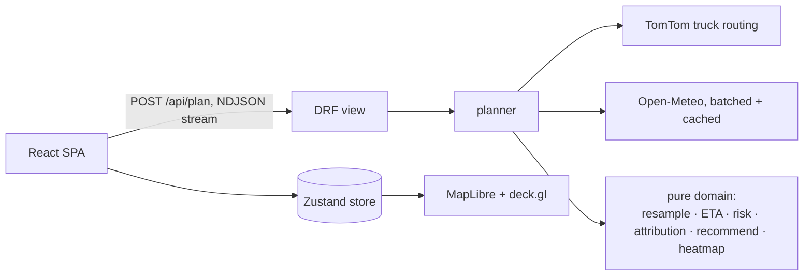

# Spotter: weather-aware truck routing

A truck driver enters an origin, a destination, a departure time and a load weight. Spotter
fetches three truck routes, checks the weather **at the time the truck will reach each
checkpoint**, classifies risk with the assessment's wind/rain/snow and load rules, recommends the
safest route, and shows everything on a map with a 0–48 hour corridor weather heatmap.

- **Live app:** https://stormroute-web.onrender.com
- **API health:** https://stormroute-api-phi1.onrender.com/api/healthz
- **Video walkthrough:** _add Loom link_
- **Full walkthrough (app + code, start to end):** [`docs/WALKTHROUGH.md`](docs/WALKTHROUGH.md)
- **Design record and every spec decision:** [`PLAN.md`](PLAN.md)
- **Deploy runbook:** [`docs/DEPLOY.md`](docs/DEPLOY.md)

Stack: Django 5.2 + DRF (Python 3.12) · React 19 + TypeScript (strict) + Vite · MapLibre +
deck.gl · Zustand · TomTom Routing/Search · Open-Meteo · Render.

---

## Quick start

```bash
make setup     # installs backend (uv) and frontend (pnpm), creates backend/.env
make dev       # API on http://localhost:8000, web on http://localhost:5173
```

No TomTom key? Set `PLAN_FIXTURES=1` in `backend/.env`. The API then replays recorded TomTom and
Open-Meteo responses: no network, no quota, and the demo trip is deterministic. Append
`?fixture=no_travel_all`, `two_routes`, `upstream_429` or `no_route` to the web URL to see each
special state.

| Task | Command |
|---|---|
| All tests | `make test` |
| Lint, format, types | `make lint` |
| End-to-end (Playwright) | `make e2e` |
| Slider performance run | `pnpm -C frontend perf:slider` |
| Regenerate API types | `make api-types` |

---

## How it works



1. **Routes.** TomTom truck routing with the load weight (kg) and up to 4 alternatives.
   Near-duplicates are removed; if fewer than 3 distinct routes remain, via-point detours are
   tried. A third route is never faked. Routes stream to the browser before any weather work.
2. **Checkpoints and ETAs.** Each route is sampled every 10, 25 **and** 50 miles (all three are
   computed; a toggle switches instantly). TomTom's cumulative travel time gives each checkpoint a
   real ETA. Optional hours-of-service breaks shift later ETAs.
3. **Weather at the ETA.** Points snap to a 0.1° grid, are deduplicated across routes, intervals
   and the heatmap, cached for an hour, and fetched in batches behind a rate limiter, because
   Open-Meteo counts every location against its quota. Wind is interpolated between hours; rain
   and snow use the hour bucket containing the ETA.
4. **Risk.** One pure function, `assess(weather, weight_lb)`, for checkpoints and heatmap cells.
5. **Recommendation.** One lexicographic sort key, explained in the "Why this route" panel.
6. **Map.** The plan is decoded once into typed arrays and 49 precomputed heatmap frames. The
   slider blends frames into a reused buffer once per animation frame, outside React, with no
   network requests.

The step-by-step version, with file links, is in [`docs/WALKTHROUGH.md`](docs/WALKTHROUGH.md).

---

## Risk rules (as implemented)

| Condition | Low | Moderate | High | Severe | No Travel |
|---|---|---|---|---|---|
| Wind (mph) | < 25 | 25–34 | 35–44 | 45–54 | ≥ 55 |
| Rain (in/hr) | < 0.10 | 0.10–0.25 | 0.25–0.50 | 0.50–1.00 | > 1.00 |
| Snow (in/hr) | < 0.5 | 0.5–1.0 | 1.0–2.0 | 2.0–3.0 | > 3.0 |

Load rules on wind: ≥ 55 mph → No Travel for any load; 45–54 mph and > 30,000 lb → No Travel;
35–44 mph and > 40,000 lb → Severe. Checkpoint level = worst of wind (after load rules), rain,
snow.

**Worked examples (45,000 lb):**
- Wind 38 mph, rain 0.02, snow 0 → wind band High, load rule (> 40,000 lb) → **Severe**.
- Wind 47 mph → wind band Severe, load rule (> 30,000 lb) → **No Travel**. At 25,000 lb the same
  wind stays **Severe**.
- Wind 12 mph, rain 0.25 in/hr → rain is exactly on the boundary → **High** (boundaries go to the
  worse band).

## Recommendation

Routes are sorted by `(no_weather_data, no_travel_mi, severe_mi, high_mi, avg_risk,
travel_time, route_order)`, smaller first. The middle four are the spec's order. The two safety
steps in front ensure a route with no weather data can never win and No Travel counts before
Severe. Average risk is distance-weighted on a 0–4 scale. Time only decides between routes with
equal risk, exactly as the spec's list is written.

## Spec interpretations

| Ambiguity | Decision |
|---|---|
| "Every 10 / 25 / 50 miles" | All three computed in one response; UI toggle; separate recommendation each. |
| Band edges | Lower bound inclusive, so a boundary value goes to the worse band. Explicit `>` honored (rain 1.00 = Severe). No rounding. |
| Wind metric | Sustained 10 m wind. Gusts shown, not scored (no gust thresholds given). |
| Miles per checkpoint | Each checkpoint owns half the gap to each neighbor; owned miles sum to route length. |
| No Travel in ranking | Ranked before Severe miles. If every route has No Travel, a blocking banner says so. |
| Weather time | Wind interpolated between hours; precipitation from the hour bucket containing the ETA. All UTC. |
| Departure | Local time in the origin's zone; now to +7 days; weather looked up to 16 days. |
| Fewer than 3 routes | Via-point detours, then a banner. Never a fake route. |
| Hours of service | Optional toggle, default off. |

Full table with reasons: [`PLAN.md` §2](PLAN.md).

---

## Quality and performance

- **Tests:** about 400 backend tests (pytest + hypothesis: every band boundary, every load-rule
  combination, each comparator step deciding alone, property tests for resampling and mile
  ownership; API tests replay recorded TomTom/Open-Meteo responses), about 75 frontend unit tests
  (Vitest), and Playwright end-to-end tests for the happy path, every error state and the phone
  layout.
- **CI:** ruff, mypy `--strict`, oxlint, Prettier, tsc, all tests, build, OpenAPI/TypeScript type
  drift, E2E. Render deploys only after CI passes.
- **Slider:** p95 frame time 16.7 ms (60 fps), 0 dropped frames, 0 long tasks, 0 network
  requests while scrubbing, also at 4× CPU throttling (`frontend/e2e/perf/last-run.json`).
- **Payload:** a full plan is about 20–35 KB gzipped.

## Known limits

- Sustained wind only; gusts are displayed but not scored.
- Weather lookup snaps to a 0.1° grid (≤ about 7 km).
- Open-Meteo's free tier is counted per IP, and Render's outbound IP is shared, so on busy days
  the daily weather quota can run out (it resets at 00:00 UTC). The app shows "Service busy"
  with a retry time instead of failing silently.
- The free API instance can sleep; a 10-minute pinger keeps it warm, and the app shows a
  "Waking the server" banner if it does sleep.
- Hours-of-service is simplified (fresh clocks, no 60/70-hour rule). No road closures beyond
  TomTom's truck profile.

## Data sources

Routing and geocoding by [TomTom](https://developer.tomtom.com). Weather data by
[Open-Meteo.com](https://open-meteo.com) (CC BY 4.0). Basemap by
[OpenFreeMap](https://openfreemap.org), © OpenMapTiles, data © OpenStreetMap contributors.
