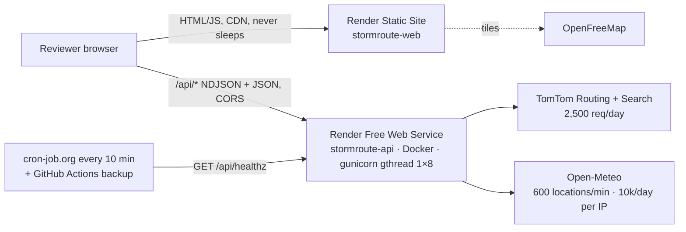

# Deploy runbook: Render (free tier)

Goal: a reviewer opens one URL at any time and sees a working, fast app with no sleeping-server dead end.
Render facts below were checked against Render's docs on 2026-11-14. Anything I couldn't confirm is marked **unverified**.



---

## 0. Gate: do not deploy until all of these are true

| # | Blocker | Why it matters | Fix |
|---|---|---|---|
| G1 | ~~The M5 session is still running.~~ **Done:** M5 finished and committed (through `83baad0`). | Deploying mid-change ships half a milestone. | — |
| G2 | ~~CI on `main` is red (flaky Open-Meteo 429 retry count).~~ **Done:** `780ed51` counts retries per batch. CI green since. | Once deploys are gated on checks, red CI blocks every deploy. | — |
| G3 | ~~A route with no weather data at all can be recommended.~~ **Done:** `2e47659` adds a leading `no_weather_data` key, so such a route ranks after every route that has data. | Logic bucket (40%). | — |
| G4 | ~~Heatmap grid can coarsen to 5° cells.~~ **Done:** `c51bd56` caps the stride at 0.5° and narrows the corridor instead. | Meaningless cells on long trips. | — |
| G5 | **The TomTom key was pasted into a chat transcript.** | Treat it as exposed. | TomTom Dashboard → Keys → regenerate. Put the new key in `backend/.env` and in Render only. |
| G6 | No `README.md` yet (M6). | The reviewer's first click after the URL. Not a deploy blocker, but required before you share the link. | Write it in M6 (outline in PLAN.md §14). |

---

## 1. Code and config changes before the first deploy

**Status: applied.** `render.yaml`, settings (1.2), the boot warm-up (1.3) and the keep-warm workflow (1.4) are in the repo, and `scripts/smoke_deploy.py` automates section 4.1. The snippets below explain the reasons.

### 1.1 `render.yaml`

The Blueprint spec describes `dockerfilePath` and `dockerContext` as **relative to the repo root**. It does not say they're relative to `rootDir` (https://render.com/docs/blueprint-spec). Today's `rootDir: backend` + `dockerfilePath: ./Dockerfile` could therefore look for `/Dockerfile` and fail. Make the paths unambiguous, and use `buildFilter` for "only rebuild when this folder changes".

```yaml
services:
  - type: web
    name: stormroute-api              # unique, distinctive name -> predictable onrender.com subdomain
    runtime: docker
    plan: free
    region: oregon
    dockerContext: ./backend
    dockerfilePath: ./backend/Dockerfile
    buildFilter:
      paths: ["backend/**"]
      ignoredPaths: ["backend/trips/tests/**"]
    healthCheckPath: /api/healthz
    autoDeployTrigger: checksPass     # deploy only after GitHub CI passes (values: commit | checksPass | off)
    envVars:
      - { key: DJANGO_SECRET_KEY, generateValue: true }
      - { key: DJANGO_DEBUG, value: "0" }
      - { key: CORS_ALLOWED_ORIGINS, value: https://stormroute-web.onrender.com }
      - { key: TOMTOM_API_KEY, sync: false }        # Render prompts for it on Blueprint creation
      - { key: PLAN_FIXTURES, value: "0" }

  - type: web
    name: stormroute-web
    runtime: static
    rootDir: frontend
    buildFilter:
      paths: ["frontend/**"]
    autoDeployTrigger: checksPass
    # Render's preinstalled pnpm version is unreliable and corepack may not be enabled, so pin pnpm with npx.
    buildCommand: npx --yes pnpm@11.1.1 install --frozen-lockfile && npx --yes pnpm@11.1.1 run build
    staticPublishPath: ./dist
    envVars:
      - { key: NODE_VERSION, value: "24" }
      - { key: VITE_API_BASE_URL, value: https://stormroute-api.onrender.com }
    routes:
      - { type: rewrite, source: /*, destination: /index.html }
    headers:
      - { path: /assets/*, name: Cache-Control, value: "public, max-age=31536000, immutable" }
      - { path: /index.html, name: Cache-Control, value: "no-cache" }
      - { path: /*, name: X-Content-Type-Options, value: nosniff }
      - { path: /*, name: Referrer-Policy, value: strict-origin-when-cross-origin }
      - { path: /*, name: X-Frame-Options, value: DENY }
      - path: /*
        name: Content-Security-Policy
        value: >-
          default-src 'self';
          script-src 'self';
          style-src 'self' 'unsafe-inline';
          img-src 'self' data: blob: https://tiles.openfreemap.org;
          font-src 'self' data:;
          connect-src 'self' https://stormroute-api.onrender.com https://tiles.openfreemap.org;
          worker-src 'self' blob:;
          frame-ancestors 'none'
```

Notes:
- `ALLOWED_HOSTS` is dropped from the Blueprint. Settings read Render's own hostname instead (1.2), so a renamed or suffixed subdomain can't cause 400s.
- `fromService` only exposes `host`/`hostport` (private-network host, no `https://`), so it can't fill `VITE_API_BASE_URL` or CORS. Keep them literal and correct them once in step 3.4 if Render assigns a different subdomain.
- The CSP is strict on purpose. MapLibre needs `worker-src blob:` and inline styles. **Verify in the browser (step 4.2)**: any CSP violation in the console means you loosen the matching directive, not drop the CSP.

### 1.2 `backend/config/settings.py`

```python
# Render injects RENDER_EXTERNAL_HOSTNAME (e.g. stormroute-api.onrender.com) at build and runtime.
ALLOWED_HOSTS = env("ALLOWED_HOSTS") + [h for h in [os.environ.get("RENDER_EXTERNAL_HOSTNAME")] if h]
GIT_SHA = env("GIT_SHA", default=os.environ.get("RENDER_GIT_COMMIT", "dev")[:12])
if not DEBUG:
    SECURE_HSTS_SECONDS = 86_400          # 1 day: safe for a review window; Render already redirects to https
    SESSION_COOKIE_SECURE = CSRF_COOKIE_SECURE = True
```
- Add one settings test: `RENDER_EXTERNAL_HOSTNAME` ends up in `ALLOWED_HOSTS`.
- **Throttling behind the proxy:** `DRF_NUM_PROXIES` (default 0) feeds `REST_FRAMEWORK["NUM_PROXIES"]`. At 0, DRF ignores `X-Forwarded-For` and every client shares the proxy's address, so one global 10/min limit applies. `render.yaml` sets it to `0`, which is safe and can't be spoofed. Change it in the API's Environment tab to the hop count that step 4.1 measures (**unverified**: one or two).

### 1.3 Backend start-up

- Warm the slow imports once at boot in `TripsConfig.ready()`: `timezonefinder` (loads its polygon data) and a dummy `tz_at(0, 0)`. Then the first real request doesn't pay for it.
- `Dockerfile`: keep `--bind 0.0.0.0:${PORT}`. Render sets `PORT` (default 10000).

### 1.4 Keep-warm backup workflow: `.github/workflows/keep-warm.yml`

```yaml
name: keep-warm
on:
  schedule: [{ cron: "*/10 * * * *" }]
  workflow_dispatch:
jobs:
  ping:
    runs-on: ubuntu-latest
    steps:
      - run: curl -fsS --max-time 90 https://stormroute-api.onrender.com/api/healthz
```
GitHub may delay scheduled runs by many minutes and disables them after 60 days without repo activity, so this is the **backup**. cron-job.org (step 5) is the primary.

---

## 2. Accounts and secrets

| Item | Where | Who |
|---|---|---|
| GitHub repo | `Sakib-Anjum-313/stormroute` (exists) | done |
| Render account | render.com → sign up with GitHub → grant access **only to this repo** | you |
| TomTom key (new, after G5) | Render → `stormroute-api` → Environment (secret) | you |
| cron-job.org account | free, no card | you |

| Env var | Service | Value | Secret |
|---|---|---|---|
| `DJANGO_SECRET_KEY` | api | generated by Render | yes |
| `DJANGO_DEBUG` | api | `0` | no |
| `CORS_ALLOWED_ORIGINS` | api | `https://<web subdomain>.onrender.com` | no |
| `TOMTOM_API_KEY` | api | your new key | **yes** |
| `PLAN_FIXTURES` | api | `0` (fixtures aren't in the image) | no |
| `OPEN_METEO_API_KEY` | api | empty (set only if you buy a plan, see §7) | yes |
| `NODE_VERSION` | web | `24` | no |
| `VITE_API_BASE_URL` | web | `https://<api subdomain>.onrender.com` (baked in at **build** time) | no |

---

## 3. First deploy (Blueprint)

1. All of section 0 is done. `git push`. CI on `main` is **green**.
2. Render Dashboard → **New → Blueprint** → pick `stormroute` → branch `main`. Render reads `render.yaml` and lists 2 services.
3. Enter `TOMTOM_API_KEY` when prompted → **Apply**. Watch both build logs:
   - API: the Docker build (uv sync) and `/api/healthz` passing the health check.
   - Web: `pnpm install` and `vite build`, ending with `dist/` published.
4. **Check the real URLs** on each service page. If Render added a suffix (for example `stormroute-api-abcd.onrender.com`):
   - API → Environment: set `CORS_ALLOWED_ORIGINS` to the real web URL. It redeploys itself.
   - Web → Environment: set `VITE_API_BASE_URL` to the real API URL, update the CSP `connect-src` in `render.yaml`, commit, and **Manual Deploy → Clear cache & deploy**. Vite bakes env in at build time, so an env change alone does nothing until a rebuild.
5. Run section 4 completely.

---

## 4. Smoke tests (run after every deploy that changes behavior)

Set `API=https://stormroute-api.onrender.com` and `WEB=https://stormroute-web.onrender.com`.

### 4.1 API

**Automated:** `uv run --directory backend python ../scripts/smoke_deploy.py --api $API --web $WEB` runs every row below, plus the SPA and web-header checks, and exits non-zero on any failure. It was verified locally against a production-like gunicorn in fixture mode: 11/12 passed, and the 12th is the CSP/cache headers that only Render adds. The table is for reading failures or checking by hand.


| Check | Command | Pass |
|---|---|---|
| Health + version | `curl -s $API/api/healthz` | `{"status":"ok","version":"<commit sha>"}` |
| **Stream not buffered by Render's proxy** | `uv run --directory backend python -c "import httpx,time;t=time.monotonic();[print(round((time.monotonic()-t)*1000),l) for l in httpx.stream('GET','$API/api/healthz/stream',headers={'Accept-Encoding':'gzip'}).__enter__().iter_lines()]"` | lines about 300 ms apart (≤ 1 line of lag from client gzip decoding). If they arrive all at once, the proxy buffers: switch to SSE framing (`text/event-stream`) |
| CORS preflight | `curl -si -X OPTIONS $API/api/plan -H "Origin: $WEB" -H "Access-Control-Request-Method: POST" -H "Access-Control-Request-Headers: content-type"` | `access-control-allow-origin: $WEB` |
| CORS rejects others | same with `-H "Origin: https://evil.example"` | no `access-control-allow-origin` |
| Geocode | `curl -s "$API/api/geocode?q=denver"` | 5 results with lat/lon |
| Plan, cold then warm | `curl -s -o /dev/null -w "%{http_code} %{time_total}s\n" -D - -H 'Accept: application/json' -H 'Content-Type: application/json' -d "$DEMO" $API/api/plan` twice | 200 both times. Read `Server-Timing`: cold ≤ 8 s, warm ≤ 1 s |
| **Compute on the free CPU** | `compute;dur=` in `Server-Timing` | ≤ 1.5 s. If more, optimize route dedupe and Douglas–Peucker (grid index or simplify before dedupe). They took 120–250 ms on an M1, and the free instance has a fraction of a CPU (**unverified**: Render's free page doesn't state CPU or RAM) |
| Proxy hops | log `request.META["HTTP_X_FORWARDED_FOR"]` once (temporary debug line or Render logs) | count entries → set `DRF_NUM_PROXIES` in the API's Environment tab |
| Errors are JSON | `curl -s -X POST $API/api/plan -H 'Content-Type: application/json' -d '{}'` | 400 `{"error":{"code":"VALIDATION",...}}` |
| No debug pages | `curl -s $API/nope` | JSON 404, not Django's yellow page |

The smoke script builds the Denver → Salt Lake City 45,000 lb request with `departure_local` set to tomorrow 06:00 Denver time.

### 4.2 Web (browser, per the `verify-ui` skill, on the production URL)

1. `$WEB` loads in under 2 s, and a deep link `$WEB/anything` also serves the app (SPA rewrite).
2. **Console: 0 errors, 0 CSP violations.**
3. Demo trip: routes stream in grey and then color, 3 cards, recommendation, the Why panel, popups.
4. Slider scrub 0–48 h: smooth, **0 network requests**.
5. Interval toggle 10/25/50 and HOS toggle work.
6. Phone width (375 px): the bottom sheet works and there's no horizontal scroll.
7. Cold start: suspend the API, or wait 15+ min with no pinger, then reload `$WEB`. The "Waking the server…" banner shows, and the app works once the API is up.
8. Optional: `PLAYWRIGHT_BASE_URL=$WEB pnpm -C frontend e2e` against production. It uses about 3 TomTom calls and about 400 Open-Meteo locations per run, so run it once, not in a loop.

---

## 5. Keep the API warm

| Layer | Setup | Notes |
|---|---|---|
| Primary | cron-job.org → new job → `GET $API/api/healthz`, every **10 min**, timeout 30 s, notify by email after 2 failures | Free, minute-level schedules. The email doubles as uptime alerting |
| Backup | `.github/workflows/keep-warm.yml` (1.4). After the first deploy, set the repo variable `API_URL` (GitHub → Settings → Secrets and variables → Actions → Variables) to the API URL. The job stays off until then | Best effort |
| UX fallback | the SPA's cold-API banner (built in M4) | Covers a pinger outage |

Hours budget: one always-on free service uses at most 744 h in a 31-day month, under the 750 free instance-hours per workspace (https://render.com/docs/free). **Don't run any other free web service in this workspace**, or both get suspended when the hours run out. Static sites don't use instance hours.

Never pre-warm the weather cache on a schedule. One cold demo plan costs about 400 Open-Meteo locations, so hourly warming would use most of the 10,000/day quota.

---

## 6. Monitoring

- **Render logs** (service → Logs): request id, upstream timings, `UPSTREAM_*` warnings.
- **Quota watch:** log Open-Meteo's `x-ratelimit-remaining` on every batch, and check the TomTom Dashboard → Usage the day before review.
- **Uptime:** cron-job.org failure emails (5).

---

## 7. Quota and shared-IP risk (Open-Meteo)

Open-Meteo's free limit is counted **per IP**, and Render's free services share outbound IPs with other tenants. Another app on the same IP can eat the quota. Defenses, in order:
1. Already built: point snapping and dedupe, a per-plan location budget, a 1 h cache, a token bucket, retries, and partial-data handling (routes still show, missing weather is flagged).
2. If you see `UPSTREAM_RATE_LIMITED` on review day: wait a minute (the per-minute window resets) and tell the reviewer in the README that this is a free-tier limit.
3. Paid escape hatch: an Open-Meteo API plan plus `OPEN_METEO_API_KEY` switches to the customer host (**unverified price**; check https://open-meteo.com/en/pricing).

TomTom: 2,500 non-tile requests/day. A plan uses 1–3 and typing in the geocoder about 5–10, so the risk is low.

---

## 8. Rollback

- Render → service → **Events → Rollback** to a previous deploy. The free tier keeps only the **two most recent prior deploys** (https://render.com/docs/free).
- Or `git revert <sha> && git push`. With `autoDeployTrigger: checksPass`, Render deploys once CI is green.
- A broken frontend never needs an API rollback (and the reverse holds too). The two services deploy independently.

---

## 9. Review-day checklist

**T−1 day**
- [ ] CI green on `main`, and both services show the latest commit sha (`/api/healthz` `version`).
- [ ] Section 4 smoke tests pass.
- [ ] cron-job.org history shows 10-min pings with no failures for 24 h.
- [ ] TomTom usage is low. Render instance hours used this month are under 600.
- [ ] Pick the demo trip and departure with live weather, and update the demo preset if needed.
- [ ] Record the Loom on the production URL.

**T−1 hour**
- [ ] Open `$WEB` and run the demo once (warms the routing and weather caches for the reviewer's first click).
- [ ] Console clean.

**After the review**
- [ ] Pause the pinger.
- [ ] Rotate the TomTom key.
- [ ] Optionally suspend the services.

---

## 10. Risks

| Risk | Likelihood | Mitigation |
|---|---|---|
| Render's proxy buffers NDJSON | low–medium | The 4.1 stream probe on the first deploy. SSE fallback |
| Free CPU makes compute slow | medium | `Server-Timing` check. Optimize dedupe/DP (1.5 s budget) |
| Pinger fails, so the reviewer sees a cold start | low | Two pingers and the in-app wake banner |
| Shared-IP Open-Meteo quota | medium | §7 |
| CSP breaks the map | medium on first deploy | 4.2 console check. Loosen one directive at a time |
| Subdomain differs from the service name | low (distinctive names) | 3.4 one-time correction |
| Free instance hours run out | low | One free web service only (§5) |
| TomTom display terms on an OSM basemap (**unverified**) | low for a take-home | Fallback is TomTom's MapLibre style with the same key |

Sources: [Render Blueprint spec](https://render.com/docs/blueprint-spec) · [Render default env vars](https://render.com/docs/environment-variables) · [Render free tier](https://render.com/docs/free) · [Render Node version](https://render.com/docs/node-version) · [Render community: pnpm version on Render](https://community.render.com/t/err-pnpm-bad-pm-version-this-project-is-configured-to-use-v9-0-4-of-pnpm-your-current-pnpm-is-v9-0-2/20966) · [Open-Meteo pricing](https://open-meteo.com/en/pricing)
