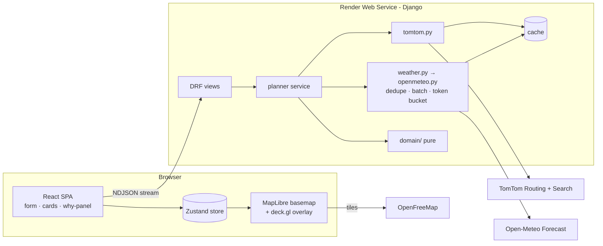

# Spotter walkthrough: the app and the code, start to end

This guide follows one trip from the moment a driver opens the app to the moment the map is
scrubbing through 48 hours of weather. Part 1 is the user's view. Part 2 follows the same request
through the code, file by file. Part 3 covers how correctness and smoothness are proven.

- Live app: https://stormroute-web.onrender.com
- API: https://stormroute-api-phi1.onrender.com/api/healthz
- Repo: https://github.com/Sakib-Anjum-313/stormroute
- Design record (every decision and why): [`PLAN.md`](../PLAN.md)
- Deploy runbook: [`DEPLOY.md`](DEPLOY.md)

---

## Part 1: Using the app

### 1.1 First load

The page is a static site on Render's CDN, so it paints immediately. In the background it calls
`GET /api/healthz`. The API runs on a free Render instance that can sleep, so if health takes
longer than 2 seconds a **"Waking the server…"** banner appears and the submit buttons wait until
the API answers. A pinger (cron-job.org every 10 minutes, plus a GitHub Actions backup) keeps it
warm, so reviewers rarely see this.

Layout on desktop: a left panel (form, route cards, "Why this route") and the map on the right.
On a phone (under 768 px) the map takes the top of the screen and a bottom sheet holds three tabs:
**Trip**, **Routes**, **Why**.

### 1.2 Enter the trip

| Field | What it does |
|---|---|
| **Origin / Destination** | Autocomplete (TomTom Fuzzy Search, proxied through our API, limited to US/CA/MX). You must pick a suggestion so the coordinates are exact. |
| **Departure** | Local time **in the origin's time zone**. The label shows the zone once the origin is picked, for example "Departure (America/Denver)". Range: now to 7 days ahead. |
| **Load weight** | Pounds, 1–200,000. Over 80,000 lb (the federal gross limit) shows a warning but is allowed, for permit loads. |
| **Hours-of-service breaks** | Optional, off by default. Adds a 30 min break after 8 h of driving and a 10 h rest after 11 h (49 CFR §395.3). |

**Try demo trip** fills Denver, CO → Salt Lake City, UT, 45,000 lb, departing at the next 06:00
local, and submits it.

### 1.3 Watching the plan arrive

The response is streamed, so the user sees real progress, not a spinner:

1. **Routing ✓**: three grey routes appear on the map in about 1–2 seconds (warm) and the route
   cards show distance, duration and arrival time.
2. **Weather n/N**: the counter advances once per weather batch.
3. **Scoring**: the routes turn into risk colors, the cards fill in, and one card gets the
   **Recommended** badge.

### 1.4 Reading the result

**Route cards** (one per route, A/B/C in TomTom's order):
- Distance, duration (including HOS stops if on), arrival time in the origin's zone.
- A stacked bar of miles by level (Low, Moderate, High, Severe, No Travel, No data).
- Average risk on a 0–4 scale and the worst level reached.
- No Travel and Severe badges.

Hovering a card highlights its path on the map, and hovering a path highlights its card. Clicking
either selects that route. The selected route is drawn in risk colors segment by segment; the
others are grey with a colored casing.

**Checkpoint interval (10 / 25 / 50 mi)**: the spec says "sample every 10 / 25 / 50 miles". The
backend computes all three in one response, each with its own totals and recommendation, so this
toggle switches instantly with no network call. If the recommendation is the same at all three
densities, it is a robust answer.

**Checkpoints**: dots along each route colored by level. Hover for a quick tooltip; click for the
full popup:
- route, mile, ETA (origin zone, plus the local zone if different),
- wind and gust in mph, rain and snow in in/hr, *at the truck's ETA*,
- the level for each variable and the overall level,
- the rules that fired, in plain text, for example
  `wind 47 mph with 45,000 lb > 30,000 lb → No Travel`.

**Why this route?** A table with the comparator's steps as rows and the routes as columns:

| Step | Meaning |
|---|---|
| 0. No weather data at all | A route whose weather failed completely ranks last (safety gate). |
| 1. No Travel miles | Fewer is better. Added before the spec's list: No Travel is worse than Severe. |
| 2. Severe miles | Spec step 1 |
| 3. High miles | Spec step 2 |
| 4. Average risk (0–4) | Spec step 3, distance-weighted |
| 5. Travel time | Spec step 4 |

The cell that decided the ranking is highlighted, and one sentence explains it, for example
"B wins at Severe miles: 0.0 vs A 18.5 and C 7.0".

**Banners**:
- Red: "No Travel conditions on Route X" (names the miles and cause), or "No safe route for this
  departure and load" if every route has No Travel.
- Yellow: fewer than three routes, coarser weather sampling on very long trips, partial weather
  data, or part of the trip beyond the 16-day forecast.

### 1.5 The 0–48 h heatmap

The bottom bar has a **play/pause** button and a slider for **hours after departure** (0–48,
keyboard arrows step 1 h). The label shows the clock time in the origin's zone and the offset,
for example "Mon 11:00 MST · +5 h".

- The corridor around all three routes is covered by weather cells colored on the **same scale
  and with the same load rules** as the checkpoints.
- Between whole hours the colors crossfade, so scrubbing looks continuous.
- One **truck ghost** per route rides along at the slider time, placed by ETA. It is stationary
  during HOS stops and hidden before departure and after arrival.
- Scrubbing makes **zero network requests**: all 49 frames came with the plan.

### 1.6 Legend, theme, errors

- The legend (bottom right) lists the five levels plus No data, each with text, never color alone.
  "Thresholds & symbols" expands the rule table.
- The sun/moon button switches between light and dark basemaps.
- Errors show a card with a specific message: no truck route, service busy (with a retry
  countdown), timeout, too many plans (10 per minute per user), or validation problems.

---

## Part 2: Following one request through the code

### 2.1 Map of the repo

```
backend/
  config/                 Django settings and URLs
  trips/domain/           PURE logic: no Django, no I/O, mypy --strict
  trips/services/         All I/O: TomTom, Open-Meteo, cache, rate limiting, the planner
  trips/api/              DRF views, serializers, NDJSON streaming, throttles, error mapping
  trips/tests/            unit/ (domain), services/, api/ (HTTP mocked with respx), fixtures/
frontend/src/
  features/trip-form/     form, autocomplete, runPlan (submit + stream)
  features/routes/        route cards, mileage bar, banners, error card
  features/explain/       "Why this route" table and sentence
  features/map/           MapLibre + deck.gl scene, layers, picking, popups, legend
  features/heatmap/       time slider
  lib/api/                NDJSON client, generated OpenAPI types, heatmap decoder
  lib/risk/               level → color and label (never re-classifies)
  store/                  Zustand stores
frontend/e2e/             Playwright specs and the slider perf script
scripts/                  fixture recorder, demo-route finder, deploy smoke test
```

The three-layer rule on the backend is the most important structural decision:
**domain** is pure functions that are easy to test exhaustively; **services** is the only place
that talks to the network; **api** is thin HTTP glue.

### 2.2 Architecture



### 2.3 Step 1: the form submits (frontend)

- [`features/trip-form/schema.ts`](../frontend/src/features/trip-form/schema.ts) validates the
  form with zod and holds `DEMO_TRIP`.
- [`features/trip-form/runPlan.ts`](../frontend/src/features/trip-form/runPlan.ts) owns a single
  `AbortController`. A resubmit aborts the previous request, and late events from it are ignored,
  so only the latest submit writes to the store.
- [`lib/api/ndjson.ts`](../frontend/src/lib/api/ndjson.ts) POSTs `/api/plan` with
  `Accept: application/x-ndjson` and parses the body line by line, including lines split across
  network chunks.

### 2.4 Step 2: the view validates and starts streaming (backend)

- [`trips/api/serializers.py`](../backend/trips/api/serializers.py) validates the request,
  finds the origin's time zone with `timezonefinder`, and converts `departure_local` to UTC.
  Internally, all time is UTC epoch seconds.
- [`trips/api/views.py`](../backend/trips/api/views.py) `PlanView` returns
  `ndjson_response(planner.stream(req))`. Django's `GZipMiddleware` buffers streams, so
  `ndjson_response` gzips each line itself with `Z_SYNC_FLUSH`: every line leaves the server
  immediately and still compressed.
- Throttles ([`throttles.py`](../backend/trips/api/throttles.py)): 10 plans/min and 60
  geocodes/min per client. On Render the client is identified by Cloudflare's
  `CF-Connecting-IP`, because `X-Forwarded-For` can be spoofed.

### 2.5 Step 3: routes (services + domain)

[`trips/services/planner.py`](../backend/trips/services/planner.py) `Planner.stream()` is the
orchestrator. Its route phase:

1. [`services/tomtom.py`](../backend/trips/services/tomtom.py) calls TomTom Routing with
   `travelMode=truck`, `vehicleWeight` in kg (lb × 0.45359237), `maxAlternatives=4` and
   `extendedRouteRepresentation=travelTime`. That last option gives cumulative travel time at
   points along the route, so ETAs are real, not proportional guesses.
2. [`domain/routes_select.py`](../backend/trips/domain/routes_select.py) drops near-duplicates
   (85% of one route within 300 m of another) and keeps the fastest plus the two most different.
3. If fewer than three remain, [`domain/detours.py`](../backend/trips/domain/detours.py) builds
   via-points offset from the midpoint on each side and asks TomTom again, accepting a detour only
   if it is distinct and at most 1.5× the fastest time. It never invents a third route; if one
   cannot be found, the plan says so with a banner.
4. Routes are simplified (Douglas–Peucker, 20 m) and encoded as polyline6. This phase is memoized
   for 15 minutes ([`services/memo.py`](../backend/trips/services/memo.py)).

Then the planner yields the `meta` and `routes` events. **The browser draws grey routes now,**
before any weather is fetched. Routing happens before the first line is sent, so "no route" and
TomTom failures still return real HTTP status codes.

### 2.6 Step 4: checkpoints and ETAs (domain)

For each route and each interval (10, 25, 50 mi):

- [`domain/geometry.py`](../backend/trips/domain/geometry.py) computes cumulative distance with
  haversine and normalizes it so the total matches TomTom's length exactly.
- [`domain/resample.py`](../backend/trips/domain/resample.py) places marks at 0, I, 2I, … and the
  destination, using binary search and interpolation along the polyline.
- [`domain/eta.py`](../backend/trips/domain/eta.py) interpolates TomTom's cumulative travel time
  by distance to get the driving time at each mark: `eta = departure + driving time + HOS stops
  before it` ([`domain/hos.py`](../backend/trips/domain/hos.py)).
- [`domain/attribution.py`](../backend/trips/domain/attribution.py) gives each checkpoint
  ownership of half the gap to each neighbor. Owned miles sum exactly to the route length
  (a property test checks this for random inputs).

### 2.7 Step 5: weather (services)

Open-Meteo's free tier counts **every location in a batch** against a 600/min and 10,000/day
quota (measured directly: 600 locations in a minute returned HTTP 429). So the weather layer is
built around spending as few locations as possible:

- Each lookup point snaps to a 0.1° grid (about 7 km at most, close to the forecast model's own
  grid). Displayed positions stay exact.
- The points from all routes × all intervals × the heatmap corridor are merged and deduplicated.
- Cached cells (1 h TTL) are skipped. Misses go out as POST batches of 100, up to 4 in parallel,
  behind a token bucket of 500 locations/min
  ([`services/ratelimit.py`](../backend/trips/services/ratelimit.py)), with retries on 429.
- A budget guard keeps a plan under 550 locations by coarsening the heatmap first, then the
  checkpoint lookup grid, and adds a warning naming what was coarsened.
- One time window per plan: from the hour before departure to the later of the last ETA and
  departure + 48 h.

Files: [`services/weather.py`](../backend/trips/services/weather.py),
[`services/openmeteo.py`](../backend/trips/services/openmeteo.py). Each finished batch yields a
`progress` event, which drives the "Weather n/N" counter.

### 2.8 Step 6: weather at the ETA (domain)

[`domain/timealign.py`](../backend/trips/domain/timealign.py) matches Open-Meteo's data meaning:

- **Wind** is an instantaneous reading at each hour, so it is **linearly interpolated** between
  the two hours around the ETA.
- **Rain, showers and snow** are totals over the preceding hour, so the ETA uses the hour bucket
  that contains it (label `ceil_hour(eta)`). Rain = rain + showers.
- A missing value gives **No data**, never Low.

### 2.9 Step 7: risk classification (domain)

[`domain/risk.py`](../backend/trips/domain/risk.py) `assess(weather, weight_lb)` is one pure
function used for both checkpoints and heatmap cells.

| Condition | Low | Moderate | High | Severe | No Travel |
|---|---|---|---|---|---|
| Wind (mph) | < 25 | 25–34 | 35–44 | 45–54 | ≥ 55 |
| Rain (in/hr) | < 0.10 | 0.10–0.25 | 0.25–0.50 | 0.50–1.00 | > 1.00 |
| Snow (in/hr) | < 0.5 | 0.5–1.0 | 1.0–2.0 | 2.0–3.0 | > 3.0 |

Load rules apply to the wind level:
- wind ≥ 55 mph → No Travel for any load,
- wind 45–54 mph and weight > 30,000 lb → No Travel,
- wind 35–44 mph and weight > 40,000 lb → Severe.

Overall level = the worst of wind (after load rules), rain and snow.

**Boundary convention:** bands are lower-bound inclusive, `[low, high)`, so a value exactly on a
boundary goes to the worse band (rain 0.25 → High, snow 1.0 → High). Where the spec writes `>`
for No Travel, that is honored: rain exactly 1.00 is Severe, snow exactly 3.0 is Severe. Values
are never rounded before classifying (34.99 mph stays Moderate).

**Wind metric:** sustained 10 m wind. Gusts are shown in the popup but not scored, because the
spec gives no gust thresholds and scoring gusts would push most routes to Moderate or worse.

Every rule that fires is returned as a trigger with a readable sentence, which the popup shows.

### 2.10 Step 8: totals and recommendation (domain)

- [`attribution.py`](../backend/trips/domain/attribution.py) `aggregate()` sums owned miles by
  level, keeps No data miles separate, and computes a distance-weighted average risk
  (Low 0 … No Travel 4) over miles that have data.
- [`domain/recommend.py`](../backend/trips/domain/recommend.py) sorts routes by one tuple, smaller
  is better:

```
(no_weather_data, no_travel_mi, severe_mi, high_mi, avg_risk, duration_min, route_index)
```

The middle four are the spec's order. Two safety steps come first, and the route index is the
final deterministic tie-break. Rounding (0.1 mi, 0.01 risk, 1 minute) only absorbs float noise.
`decided_by` records, for each losing route, the first step where it lost; `decisive_step` is the
step that separated the winner from the runner-up. The "Why" panel is built from these.

A note on "balancing risk and travel time": the spec's list is lexicographic, so time only decides
between routes whose risk is equal. That is implemented exactly as written.

This runs once per interval, so each of 10/25/50 has its own recommendation.

### 2.11 Step 9: the heatmap payload (domain)

[`domain/heatmap_grid.py`](../backend/trips/domain/heatmap_grid.py):

- Picks a lattice stride that is a multiple of 0.1° (so heatmap cells share the weather cache
  with checkpoints), the smallest giving at most 250 cells, capped at 0.5°.
- Keeps the cells within a buffer of any route (the corridor).
- For each hour 0…48 after departure, runs the same `weather_at` and `assess(…, weight_lb)`, so
  the heatmap can never disagree with the checkpoints.
- Encodes levels as Uint8 and wind/rain/snow as Uint16, frame-major, base64. A whole plan is
  roughly 20–35 KB gzipped.

The planner yields the final `result` event.

### 2.12 Step 10: decode once, then never touch React again (frontend)

- [`store/planStore.ts`](../frontend/src/store/planStore.ts) `applyPlanEvent` handles each
  event. On `result`, [`lib/plan/decodePlan.ts`](../frontend/src/lib/plan/decodePlan.ts) and
  [`lib/api/decodeHeatmap.ts`](../frontend/src/lib/api/decodeHeatmap.ts) decode everything
  **once**: polylines to coordinates, base64 to typed arrays, and 49 precomputed RGBA frames. The
  recommended route is selected.
- React renders the cards and the Why panel from the store.
- [`features/map/scene.ts`](../frontend/src/features/map/scene.ts) subscribes to the store
  **outside React**. Any change (hour, interval, hover, selection) schedules at most one
  `overlay.setProps` per animation frame.
- [`features/map/buildLayers.ts`](../frontend/src/features/map/buildLayers.ts) builds deck.gl
  layers: `PathLayer` for routes, `ScatterplotLayer` for checkpoints, `SolidPolygonLayer` for
  heatmap cells (exact lat/lon squares), `IconLayer` for pins, stops and ghosts. A slider tick
  only blends two precomputed frames into one reused buffer and bumps an `updateTrigger`. No new
  data, no new layer objects, no allocation.
- [`features/heatmap/TimeSlider.tsx`](../frontend/src/features/heatmap/TimeSlider.tsx) is an
  uncontrolled input; its time label is written straight to the DOM from a store subscription,
  so a tick causes zero React renders (a render-count test asserts this).
- [`features/map/picking.ts`](../frontend/src/features/map/picking.ts) has one root hover/click
  handler that turns deck.gl picks into hover, tooltip and popup state.
- [`lib/risk/levels.ts`](../frontend/src/lib/risk/levels.ts) maps level → color and label. The
  frontend never re-classifies; the backend is the only authority on risk.

### 2.13 The other endpoints

| Endpoint | Purpose |
|---|---|
| `POST /api/plan` | NDJSON stream `meta → routes → progress* → result`, or one JSON object with `Accept: application/json` (adds a `Server-Timing` header). |
| `GET /api/geocode?q=` | Autocomplete via TomTom Fuzzy Search. |
| `GET /api/healthz` | `{status, version}` where `version` is the deployed commit. |
| `GET /api/healthz/stream` | Probe that proves the proxy does not buffer streams. |

Errors always have one shape: `{"error": {"code", "message", "details", "retry_after_s"}}`, with
codes `VALIDATION` (400), `NO_ROUTE` (422), `RATE_LIMITED` (429), `UPSTREAM_*` (502/503/504).
OpenAPI is generated by drf-spectacular and the TypeScript types are generated from it
(`make api-types`); CI fails if either drifts.

---

## Part 3: How it is proven

### 3.1 Tests

| Layer | Tool | What |
|---|---|---|
| Domain | pytest + hypothesis | Every risk band boundary (value − ε, value, value + ε), all load-rule combinations (30,000 / 30,001 / 40,000 / 40,001 lb × winds around 35/45/55), one case where each comparator step alone decides, mile ownership sums to length for random inputs, resampling properties, ETA interpolation, time alignment, HOS stops. |
| Services / API | pytest + respx | Recorded TomTom and Open-Meteo responses: event order, fewer-than-3 routes → detours, no route → 422, 429 → retry then 503, timeouts → 504, partial weather, payload size, and the TomTom key never appearing in any response or log. |
| Frontend | Vitest + Testing Library | NDJSON parsing across chunk splits, heatmap decoding, cards, Why panel, form validation, and a render-count test for the slider. |
| E2E | Playwright | Happy path (demo → cards → toggle → popup → scrub with no requests), every error/banner state via `?fixture=`, phone layout. |

About 400 backend tests and 75 frontend unit tests. CI (GitHub Actions) runs ruff, mypy
`--strict`, pytest, oxlint, prettier, tsc, Vitest, the build, OpenAPI/type drift checks and E2E.
Render deploys only after CI passes.

### 3.2 Performance

`pnpm -C frontend perf:slider` drives the production build in Chrome, scrubs the slider for 10
seconds and records every frame. Last run (Apple M1): p95 frame time 16.7 ms (60 fps), 0 dropped
frames, 0 long tasks, 0 network requests, and the same at 4× CPU throttling. Summary file:
`frontend/e2e/perf/last-run.json`.

Backend: a warm plan (cached) takes about 50 ms on the server. A cold Denver → Salt Lake City plan
took about 8.7 s, mostly TomTom truck routing, which is why routes are streamed first.

---

## Part 4: Running it yourself

```bash
make setup          # uv sync, pnpm install, copies backend/.env.example to backend/.env
make dev            # API on :8000, web on :5173
```

No API key? Set `PLAN_FIXTURES=1` in `backend/.env`. TomTom and Open-Meteo are then served from
recorded responses, with no network and no quota, and the demo trip is deterministic. Add
`?fixture=no_travel_all`, `two_routes`, `upstream_429` or `no_route` to the web URL to see each
special state.

```bash
make test           # backend + frontend tests
make lint           # ruff, mypy, oxlint, prettier, tsc
make e2e            # Playwright against a fixture backend
```

---

## Part 5: Limits and what's next

**Known limits**
- Sustained wind only; gusts are displayed, not scored.
- Weather lookup snaps to a 0.1° grid (≤ ~7 km).
- Free-tier quotas: Open-Meteo counts per location and per IP, and Render's outbound IP is shared
  with other tenants, so the daily quota can run out on busy days. The app reports this as
  "Service busy" with a retry time.
- HOS is simplified (fresh clocks, no 60/70-hour rule).
- Forecast skill drops past ~72 h; road closures and restrictions beyond TomTom's truck profile
  are not modeled.

**With more time**
- A gust-aware rule variant if Spotter wants one.
- Ensemble forecasts to show uncertainty bands.
- NWS road-weather alerts.
- A departure-time optimizer ("leave 3 h later to avoid Severe").
- Redis and more than one instance; a paid Open-Meteo key to remove the shared-IP quota risk.
